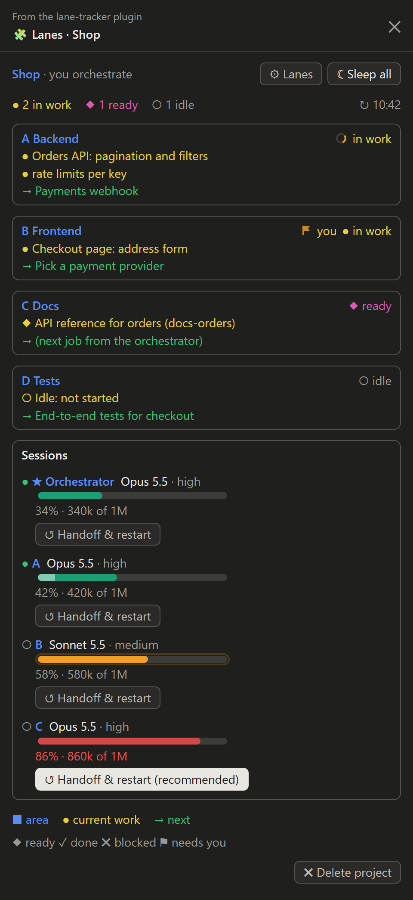
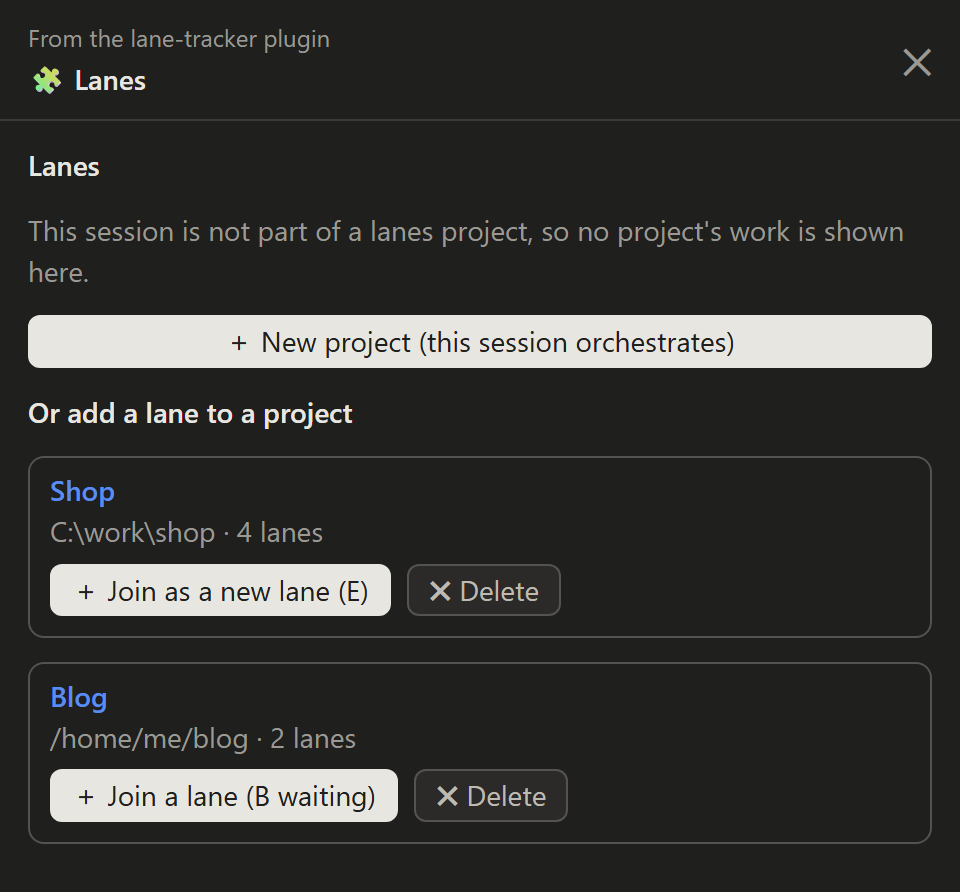
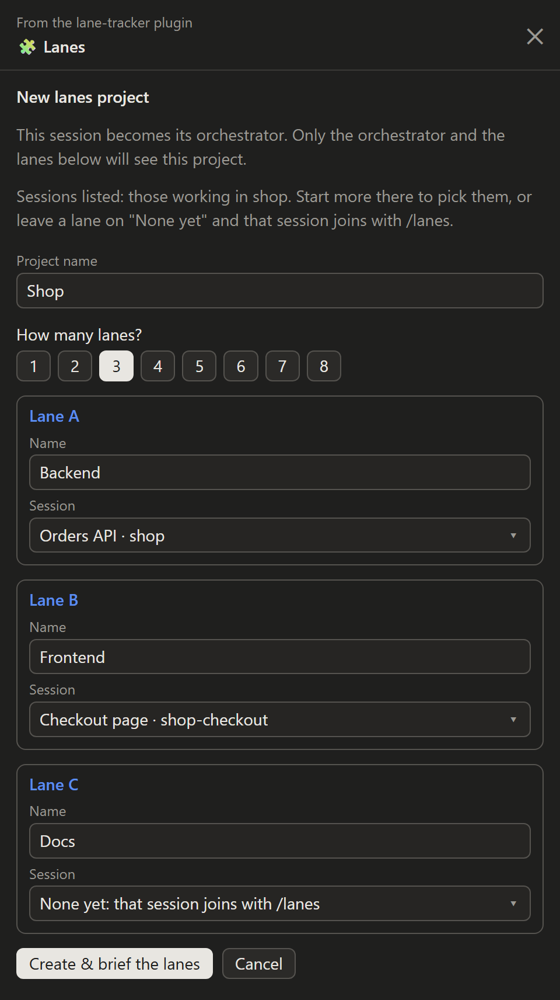

# lane-tracker

A Claude Code plugin for running one project with several Claude sessions at once: an **orchestrator** and its **lanes** (A, B, C, …). Each session of a project sees the whole team; sessions outside the project see nothing.

<p align="center"></p>

## How it looks

The **Lanes pane** (`/lanes`) of a project with four lanes, as its orchestrator sees it (above):

- **Top row:** the project, your role in it, **⚙ Lanes** to change the team and **☾ Sleep all**, then how many lanes are in work, ready and idle.
- **One card per lane:** its name (blue), what it works on now (yellow), its next job (green), and its state in the corner. The corner spins while that lane's session is running a turn, and **⚑ you** pulses while the lane waits for your decision.
- **Sessions:** each session's model and effort, and how full its context window is. The bar shimmers while the session works, gets a pulsing ring while it waits for you, and turns red and pulses from 80%. **↺ Handoff & restart** is highlighted from 60%.

<p align="center"></p>

Every session of the project also gets a status line: `Lanes ●A ⚑B ◆C ○D`.

## Getting started

1. **Open the sessions in one folder.** Start a Claude Code session in your project folder for the orchestrator, and one more for each lane. Sessions in a worktree beside it (`shop-checkout` next to `shop`) count too.
2. **Run `/lanes` in the orchestrator session.** It isn't in a project yet, so the pane offers **＋ New project**, plus the projects that already exist, each with **＋ Join** and **✖ Delete**.

   

3. **Fill in the project.** Give it a name, pick how many lanes, and name each lane. The session picker lists only the sessions working in this folder. A lane whose session doesn't exist yet stays on "None yet".

   

4. **Press Create & brief the lanes.** The plugin:
   - writes the board, one `@lane` line per lane;
   - sends each lane session a brief: its letter, its job and how to keep its board line current;
   - briefs this session as the orchestrator;
   - renames the sessions after their role, such as `Orchestrator (Shop)` and `A · Backend (Shop)`.
5. **Give the lanes their first tasks** from the orchestrator. As they work, each lane updates its board line, and every session's pane follows within seconds.

**Adding a lane later:** run `/lanes` in a new session and press **＋ Join** on the project. It takes a lane left on "None yet", or becomes the next lane (E, F, …), and the orchestrator is told. A session started in another folder is moved to the project folder; the app asks you first.

**At the end of the day:** **☾ Sleep all** has every session finish its step, commit on its own branch, write a handoff and stop. **☀ Wake up** has each one read its handoff and carry on.

**When a context fills up:** **↺ Handoff & restart** (or `/clear_context` in that session) writes a handoff, clears the session and starts it again from the handoff.

## Everything it does

- **Status line** in every session of the project: `Lanes ✓A ●B ◆C ○D`.
- **Lanes pane** (`/lanes`; opens by itself in the orchestrator):
  - one card per lane: its area (blue), what it works on now as bullets (yellow), its next job (green), and a mark for its state: ● in work, ◆ ready to merge, ✓ done, ✖ blocked, ○ idle, ⚑ waiting for you;
  - a lane's corner **moves**: it spins while that lane's session is running a turn, and its ⚑ pulses while it waits for you;
  - **Sessions**: each session's model, effort and context window use, as a bar that shimmers while the session works, gets a pulsing ring while it waits for you, and pulses red from 80%;
  - **↺ Handoff & restart**: the session writes a handoff file, clears itself, and is told to read it back (highlighted from 60% context);
  - **☾ Sleep all / ☀ Wake up**: every session finishes its step, commits to its own branch, saves a handoff and stops; Wake up has each one carry on from it;
  - **⚙ Lanes** (orchestrator): add, rename or reassign lanes.
  - **✖ Delete project** (orchestrator, after a yes): the team is forgotten in every session; the board file and handoffs stay on disk.
- **`/clear_context`** (any session): the session writes a handoff (`HANDOFF.md` in its folder, or its lane's handoff file in a project), clears itself, and the fresh session is told to read it and carry on.
- **`/lanes` outside a project** lists the projects with **＋ Join** (a new lane, or a lane waiting for a session) and **✖ Delete** next to each, and offers **＋ New project** (this session orchestrates: name, number of lanes, each lane's name and session).
  - The session picker lists only the sessions working in the project's folder (or a worktree beside it): open the lane sessions there first, or leave a lane on "None yet" and have that session join with `/lanes`.
  - A session that joins a project from another folder is moved to the project's folder (the app asks you first).
- **Session names**: each session is renamed after its role, `Orchestrator (Shop)` and `A · Backend (Shop)`, when the project is created, when it joins, and when ⚙ Lanes changes it.

The board is a plain text file of one line per lane, which the sessions keep current:

```
@lane A | Role | Feature / work item | Status | Next job | MM-DD
```

Status starts with Working, Ready to merge, Blocked, Done, Idle or Paused.

It sits next to the project folder (`<parent>/<project>-LANES.md`, handoffs in `<parent>/<project>-handoffs/`) so worktrees beside it share it. Where that folder takes no files, such as a drive root or `/home` for a project at your home folder, both go inside the project, in `.lanes/`.

## Install

In a terminal session of Claude Code:

```
/plugin install lane-tracker --marketplace Du1eks/lane-tracker
```

Answer `y` to add the marketplace and pick the user scope. From a local folder instead:

```
claude plugin marketplace add <path to this folder>
claude plugin install lane-tracker@du1eks-mods --scope user
```

## Limits

- Works in Claude Code sessions on your own computer (the desktop app's Code tab or a terminal), not in cloud sessions.
- Session details, context bars, reset, sleep and wake use the desktop app's session tools; in a plain terminal the pane shows the board only.
- The setup form needs text fields, so it runs in the desktop app or a terminal, not on mobile.
- Each install (Windows, WSL) keeps its own list of projects.

## Development

```
claude plugin validate .
claude plugin test .
```
